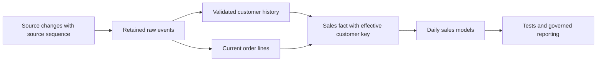

# Capstone: End-to-End Data Engineering Project

## Project Overview and Requirements Gathering

### Introduction to Project Overview

**Worked project assumption:** build daily sales reporting with historical customer-region attribution from order-line and customer changes. This example scope is added to make the capstone concrete; it is not a recovered requirement from the copied source.

| Item | Explicit definition |
| --- | --- |
| Order source | `order_line_id`, `order_id`, `customer_id`, `product_id`, `ordered_at`, `quantity`, `unit_price`, `is_deleted`, `source_sequence` |
| Customer source | `customer_id`, `customer_name`, `region`, `effective_at`, `is_deleted`, `source_sequence` |
| Fact grain | One active order line; corrections replace that line's current measures |
| Revenue | `quantity * unit_price`; taxes, discounts, returns, and currency conversion are outside this example scope |
| Historical attribute | Customer region uses Type 2 validity, joined at `ordered_at` |
| Time and ordering | Timestamps are UTC; source_sequence orders events within each source key |
| Customer deletion | Close the active version and retain permitted earlier history; retention rules may require further deletion |
| Late customer event | Rebuild affected validity intervals and re-resolve affected fact version keys |
| Late dimension | Hold affected facts in a retry queue until the required version exists; do not silently assign the latest version |

Choose one execution path: Snowflake with landed CDC, streams/tasks, and dbt, or Databricks with Delta events, jobs/declarative pipelines, and dbt. Both platforms are not required for the same exercise.

Completion criteria are: reconciled source/target counts and sales totals for a fixed boundary, unique fact keys, exactly one current version for each active customer, no overlapping customer intervals, no unresolved fact joins, correct insert/update/delete replay, and successful least-privilege access tests. Record the chosen freshness and cost targets before benchmarking rather than claiming an unspecified production SLA.

In this lesson, we will focus on understanding the importance of a clear project overview and requirements gathering for successful data engineering projects. This step lays the foundation for designing and implementing robust solutions, especially when dealing with advanced concepts like Change Data Capture (CDC) and Slowly Changing Dimensions (SCD).

- Define the goals and scope of the project.
- Understand the stakeholders' requirements and expectations.
- Identify key data sources and their characteristics.
- Outline the tools and platforms to be used.

### Stakeholders in Data Engineering Projects

Successful data engineering projects require collaboration with multiple stakeholders, including business analysts, data scientists, and IT teams. Each group has unique requirements that should be carefully documented and addressed during the planning phase.

### Business Stakeholders

Business stakeholders define the decisions the project must support, the meaning of metrics, and the acceptable freshness and correctness targets. For example, a finance owner decides whether revenue is reported by order date or settlement date and how refunds affect it. Obtain explicit approval of those definitions before modeling.

### Technical Teams

Data engineers, platform teams, database administrators, and application owners confirm source access, change-capture support, schema contracts, orchestration, and operational ownership. They also define incident handling, replay, deployment, and rollback procedures.

### Data Governance Teams

Data owners, stewards, security, and privacy teams define classification, permitted uses, retention, masking, access approval, and audit requirements. Confirm who can grant access and who is accountable for the quality and meaning of each dataset.

- **Step 1: Define Project Objectives**

  Begin by clearly outlining the goals of the project. What business problems are you solving, and how will your data engineering solutions support them?

- **Step 2: Gather Requirements**

  Agree on grain, metric definitions, timezones, deletion rules, historical requirements, freshness targets, and acceptance tests with the responsible owners.

- **Step 3: Identify Data Sources**

  Inventory each source key, schema, change marker, CDC capability, volume, retention, and access path. Identify a consistent boundary for the initial load.

- **Step 4: Evaluate Tools and Platforms**

  Choose one supported implementation path and verify permissions, feature editions, runtime support, operational skills, and expected compute/storage cost.

- **Step 5: Document Assumptions and Risks**

  Record the worked example assumptions or substitute approved requirements. Assign owners for data gaps, late-event behavior, security decisions, and recovery risks.

#### What is the purpose of a project overview in data engineering?

To establish a clear understanding of the project's goals, scope, and requirements.

#### Who are the key stakeholders in a data engineering project?

Business stakeholders, technical teams, and data governance teams.

#### Why is identifying data sources critical during requirements gathering?

It ensures that all relevant data is accounted for and accessible for processing and analysis.

### Project Goals

Ensure the goals are SMART (Specific, Measurable, Achievable, Relevant, Time-bound).

#### Which of the following is NOT a key step in the requirements gathering process?

- Define project objectives
- Identify data sources
- Select stakeholders based on technical expertise
- Evaluate tools and platforms

**Answer:** **Select stakeholders based on technical expertise.** Stakeholders are selected for business ownership, governance, and operational responsibility as well as technical involvement.

## Designing the Data Architecture and Dimensional Models

### Introduction to Data Architecture Design

For the worked project, use this flow:



`dim_customer` has one row per customer version, with `customer_key`, `customer_id`, region, and half-open validity timestamps. `fact_sales` has one row per active order line and references the customer version valid at the sale time. Before assigning that surrogate key, join the staged sale `s` to dimension `d` using `s.customer_id = d.customer_id AND s.ordered_at >= d.valid_from AND (s.ordered_at < d.valid_to OR d.valid_to IS NULL)`. The parentheses ensure an open end date cannot bypass the business-key and start-date conditions.

Designing a robust data architecture is a foundational step in ensuring that analytical workloads are both efficient and scalable. This involves understanding the requirements for data ingestion, transformation, storage, and querying while aligning with business objectives.

- Key principles of data architecture: scalability, reliability, and performance.
- Choosing between a data warehouse, data lake, or lakehouse based on use cases.
- Ensuring data governance and security are integrated into the architecture.

### Data Warehouses: Optimized for Structured Data

Use a warehouse when the capstone emphasizes governed SQL reporting over modeled data. Isolate ingestion and BI compute where supported, and select explicit types and a fact grain. Snowflake is the warehouse path described in these notes; this choice does not require a second copy of every intermediate dataset.

### Data Lakes: Handling Unstructured and Semi-Structured Data

Use object storage to retain raw source extracts or immutable CDC events for replay and investigation. Define file formats, a catalog, access restrictions, and retention. Raw storage alone does not supply reliable row updates, analytical schemas, or business-quality checks.

### Lakehouses: Bridging the Gap

Use transactional lake tables when the project needs SQL analytics and Spark or ML processing over shared data. In the Databricks path, separate raw ingestion, validated current/history tables, and serving models. These are often called bronze, silver, and gold layers; the names describe responsibilities rather than a mandatory number of copies.

### Dimensional Modeling: Star and Snowflake Schemas

Dimensional modeling is a technique for structuring data to optimize query performance and simplify analytics. The most common approaches are the star schema and snowflake schema, both of which organize data into facts and dimensions.

#### What is a star schema?

A star schema organizes data into a central fact table surrounded by related dimension tables. It is optimized for simplicity and query performance.

#### What is a snowflake schema?

A snowflake schema normalizes dimension tables, splitting them into sub-dimensions. It reduces redundancy but increases query complexity.

#### When should you use a star schema?

Use a star schema when simplicity and fast query performance are more critical than storage efficiency.

- **Step 1: Identify Business Requirements**

  Understand the key metrics and dimensions required for analytics. These will guide the design of the dimensional model.

- **Step 2: Define Facts and Dimensions**

  Set the order-line fact grain and customer version grain. Define additive sales measures and durable keys, then specify the time-based customer-version lookup.

- **Step 3: Choose the Schema Type**

  Start with a star schema for this reporting example, normalizing a dimension hierarchy only when reuse or maintenance justifies the additional joins.

- **Step 4: Optimize for Query Performance**

  Benchmark representative daily-sales queries and historical customer joins, inspect scan volume and join cardinality, and apply only beneficial engine-specific layout changes.

#### What is the primary advantage of a snowflake schema over a star schema?

- Simpler querying structure
- Reduced data redundancy
- Faster query performance
- Uses fewer tables

**Answer:** **Reduced data redundancy.** The tradeoff is additional tables and joins; it does not universally improve query speed.

### Understand the analytics requirements

Ensure you have clarity on the metrics and dimensions essential for the business.

## Implementing CDC and SCD Processes with Modern Tools

### Understanding CDC and SCD in Modern Data Engineering

Change Data Capture (CDC) and Slowly Changing Dimensions (SCD) are critical data engineering techniques for managing dynamic data. CDC focuses on capturing and processing incremental changes in source data, while SCD deals with tracking historical changes in dimensional data over time. These techniques ensure that organizations maintain accurate and up-to-date data for analytics and reporting.

- CDC enables real-time or near real-time data updates in data pipelines.
- SCD ensures historical data is preserved for accurate analysis.
- Modern tools like Snowflake, Databricks, and dbt simplify implementing these techniques.

### Modern Tools for CDC and SCD Implementation

Modern data platforms provide specialized features to implement CDC and SCD processes efficiently. Snowflake offers tools like streams for real-time change tracking, Databricks leverages Delta Lake for ACID transactions, and dbt facilitates transformation logic with incremental models and testing capabilities.

### Snowflake and CDC

Use a source connector to land external database changes in Snowflake; a Snowflake stream then tracks supported changes on the Snowflake object. Schedule or trigger tasks to apply bounded batches. A stream is not an external database-log reader and exposes net table changes rather than every intermediate business event.

### Databricks and Delta Lake

Land source events in Delta, retain a source ordering field, and apply them with an appropriate MERGE or declarative CDC flow. Use CDF to propagate changes between supported Delta tables. For complete Type 2 history, preserve ordered changes and use a history-aware application method rather than a latest-state merge.

### dbt and SCD

Use dbt to stage sources, define conformed dimensions and facts, test constraints, and publish documentation. Use snapshots for Type 2 history observed at snapshot time, a merge incremental model for current state, or a custom ordered-event history model when intermediate changes must be retained. Declare deletion and late-arrival behavior explicitly.

- **Step 1: Identify Data Sources**

  Determine the source systems where changes occur. This could include transactional databases, APIs, or flat files.

- **Step 2: Configure CDC or SCD Mechanisms**

  Capture source operation, stable key, source sequence, and effective time. Configure initial-load boundaries, delete capture, retention, and customer Type 2 rules.

- **Step 3: Use Modern Tools for Pipeline Development**

  Land immutable events, apply ordered customer history changes, merge order-line corrections, and resolve dimension keys as of ordered_at. Use the chosen platform path consistently.

- **Step 4: Validate and Monitor**

  Reconcile at a fixed source position; test insert, update, delete, unchanged replay, duplicate delivery, failure/restart, and late events. Alert on unresolved fact keys and consumer lag.

#### What is the purpose of Change Data Capture (CDC)?

CDC captures and processes incremental changes in the source data to ensure real-time or near real-time updates.

#### Which tool provides streams for tracking data changes in real-time?

Snowflake provides streams for real-time change tracking.

#### How does dbt support Slowly Changing Dimensions (SCD)?

dbt supports SCD with incremental models and snapshot functionality to track historical changes.

#### Which of the following is NOT a feature provided by modern tools for CDC and SCD?

- Real-time change tracking
- ACID transactions
- Guaranteed recovery of source changes that were never captured
- Incremental data loads

**Answer:** **Guaranteed recovery of source changes that were never captured.** Tools cannot reconstruct a missing event history without another authoritative source. Manual SQL transformations are supported and therefore were not a valid negative option.

### Verify CDC Configuration

Ensure that change streams or replication mechanisms are correctly configured in your source system.

## Building Advanced SQL Transformations and dbt Workflows

### Introduction to Advanced SQL Transformations

Advanced SQL transformations allow data engineers to create complex queries that optimize analytical workloads and facilitate efficient data modeling. In this lesson, we will explore techniques such as window functions, recursive queries, and common table expressions (CTEs) to address real-world data engineering challenges.

- Learn how to implement complex joins and subqueries.
- Understand the use of window functions for ranking and aggregation.
- Master recursive queries for hierarchical data processing.
- Explore strategies for incremental transformations using dbt.

### Window Functions for Analytics

Window functions calculate values across related rows while preserving row-level detail. For running totals, specify the partition, order, and frame; for rankings, decide how ties should behave. This standalone **Snowflake SQL** example first aggregates to one row per customer per day, avoiding ambiguous ordering of same-day sales.

```sql
CREATE TEMP TABLE project_sales (
  order_line_id NUMBER, customer_id NUMBER, order_date DATE,
  amount NUMBER(12,2)
);
INSERT INTO project_sales VALUES
  (1, 1, '2026-01-01', 10), (2, 1, '2026-01-01', 5),
  (3, 1, '2026-01-02', 20), (4, 2, '2026-01-01', 7);

WITH daily_sales AS (
  SELECT customer_id, order_date, SUM(amount) AS daily_amount
  FROM project_sales
  GROUP BY customer_id, order_date
)
SELECT customer_id, order_date, daily_amount,
       SUM(daily_amount) OVER (
         PARTITION BY customer_id ORDER BY order_date
         ROWS BETWEEN UNBOUNDED PRECEDING AND CURRENT ROW
       ) AS running_amount
FROM daily_sales
ORDER BY customer_id, order_date;
```

Customer `1` has daily totals `15` and `20` and running totals `15` and `35`; customer `2` has `7`. A window aggregate does not remove rows as GROUP BY does.

### Recursive Queries for Hierarchical Data

A recursive CTE starts with an anchor set and repeatedly joins child rows to the prior result. For a hierarchy, define the root rule and detect cycles in the source; a depth guard prevents runaway execution but is not a substitute for validating the hierarchy.

This independent Snowflake SQL example uses a valid three-level employee tree:

```sql
CREATE TEMP TABLE project_employees (
  employee_id NUMBER, manager_id NUMBER, employee_name VARCHAR
);
INSERT INTO project_employees VALUES
  (1, NULL, 'Asha'), (2, 1, 'Ravi'), (3, 2, 'Meera');

WITH RECURSIVE org(employee_id, manager_id, employee_name, depth) AS (
  SELECT employee_id, manager_id, employee_name, 0
  FROM project_employees WHERE manager_id IS NULL
  UNION ALL
  SELECT e.employee_id, e.manager_id, e.employee_name, o.depth + 1
  FROM project_employees AS e
  JOIN org AS o ON e.manager_id = o.employee_id
  WHERE o.depth < 20
)
SELECT * FROM org ORDER BY depth, employee_id;
```

The expected depths are `0`, `1`, and `2`. Before using this pattern on arbitrary input, reject duplicate employee keys, orphan managers, and cycles; a rootless cycle would otherwise be absent from the output.

### dbt Workflow Optimization

Separate source cleanup, reusable intermediate models, dimensions/facts, and serving aggregations. Use ref() dependencies to build in order, materialize repeated expensive work when useful, and apply incremental logic only with a tested source-change contract. Run builds and tests in isolated development schemas and deploy reviewed definitions with scheduled jobs.

- **Step 1: Define the Data Transformation Goals**

  Begin by identifying what insights or outputs are required from the data transformation process. This will guide query design and optimization.

- **Step 2: Use SQL to Implement Transformations**

  Use explicit grain and join predicates; run the window and recursive examples, and compare the results with their stated expected outputs.

- **Step 3: Develop Incremental Models in dbt**

  Create staged sources and incremental current-state or history models using tested change markers. Keep historical customer logic separate from current-state order-line correction logic.

- **Step 4: Test and Validate Results**

  Test unique fact keys, amount calculations, historical region joins, row counts, and no-change replay. Validate recursive hierarchy assumptions before running on arbitrary data.

#### What is the primary use of window functions in SQL?

Window functions are used for advanced analytics, such as ranking, aggregations, and calculating moving averages over subsets of data.

#### How does dbt optimize incremental data transformations?

dbt uses incremental models to process only new or updated data, reducing the computational workload and enhancing pipeline efficiency.

#### What is a common use case for recursive SQL queries?

Recursive SQL queries are often used for processing hierarchical data structures, like organizational charts or tree-based models.

#### Which of the following is NOT a feature of window functions?

- Calculating running totals
- Ranking data subsets
- Joining tables
- Calculating moving averages

**Answer:** **Joining tables.** Joins combine rows from relations; window functions compute over a related set of rows in an existing query result.

### Understand Window Functions

Review SQL examples demonstrating ranking, aggregation, and moving averages.

## Performance Tuning and Governance for Production Readiness

### Introduction to Performance Tuning and Governance

Performance tuning and governance are critical aspects of ensuring production readiness in modern data engineering workflows. This lesson will explore techniques to optimize query performance, manage resource allocation, and enforce governance policies to maintain data integrity and security.

- Understanding query optimization and execution plans
- Leveraging indexing and partitioning for faster data retrieval
- Implementing clustering in Snowflake for efficient query performance
- Monitoring and managing resource usage in Databricks
- Establishing data governance policies using role-based access control (RBAC)

#### What is a query execution plan?

A query execution plan is a detailed roadmap used by the database engine to execute SQL queries efficiently. It includes information on operations like joins, filters, and scans.

#### Why is clustering important in Snowflake?

Clustering in Snowflake helps optimize query performance by organizing data within micro-partitions based on specified columns, reducing the number of partitions scanned during queries.

#### What is role-based access control (RBAC)?

RBAC is a governance model that assigns permissions to users based on their roles, ensuring secure access to data and resources within a platform.

Effective governance involves setting up policies to control data access, monitor usage, and ensure compliance with organizational standards. Tools like Snowflake's RBAC and Databricks' workspace permissions allow granular control over data workflows.

### Query Optimization Techniques

Use query profiles to locate the actual bottleneck: scanned data, expensive joins, sorting, shuffle, or queue time. Filter early where semantics allow, read only required columns, join on appropriate keys, and aggregate at the required grain. Evaluate engine-specific pruning, clustering, file layout, or supported indexes; validate results as well as speed.

### Resource Management in Databricks

Choose job or SQL compute suited to the workload, set appropriate autoscaling and termination behavior, and isolate competing workloads. Inspect Spark task skew, shuffle spill, executor memory, and source/sink throughput. More workers cannot repair an incorrect join or a single serial bottleneck; compare cost per successful refresh.

### Governance Policies for Compliance

Classify sensitive fields, grant access by approved roles or groups, apply supported row/column policies, and log access and changes. Define retention and deletion obligations, ownership, and periodic access reviews. In Databricks use Unity Catalog privileges for data governance; workspace permissions alone do not define every table-level access rule.

### Enable Query Execution Monitoring

Use tools like Snowflake's Query History and Databricks' Spark UI to track performance metrics.

- **Step 1: Analyze Query Performance**

  Use execution plans to identify bottlenecks and apply optimization techniques such as indexing or clustering.

- **Step 2: Configure Resource Allocation**

  Select a compute size from measured refresh and reporting runs, set scaling/termination limits, and monitor cost against agreed targets.

- **Step 3: Implement Governance Policies**

  Grant a reporting role only the required datasets and compute access; apply sensitive-field policies, test denied writes, record lineage, and rehearse recovery and access revocation.

#### Which of the following is NOT a governance feature in Snowflake?

- Role-based access control (RBAC)
- Data masking
- Cluster autoscaling
- Query auditing

**Answer:** **Cluster autoscaling.** It is a capacity/performance feature, while RBAC, data masking, and query auditing support governance.

### References

- [Snowflake streams](https://docs.snowflake.com/en/user-guide/streams-intro)
- [Snowflake window-function syntax](https://docs.snowflake.com/en/sql-reference/functions-window-syntax)
- [Snowflake recursive CTEs](https://docs.snowflake.com/en/user-guide/queries-cte)
- [Databricks Unity Catalog](https://docs.databricks.com/aws/en/data-governance/unity-catalog/)
- [dbt data tests](https://docs.getdbt.com/docs/build/data-tests)
