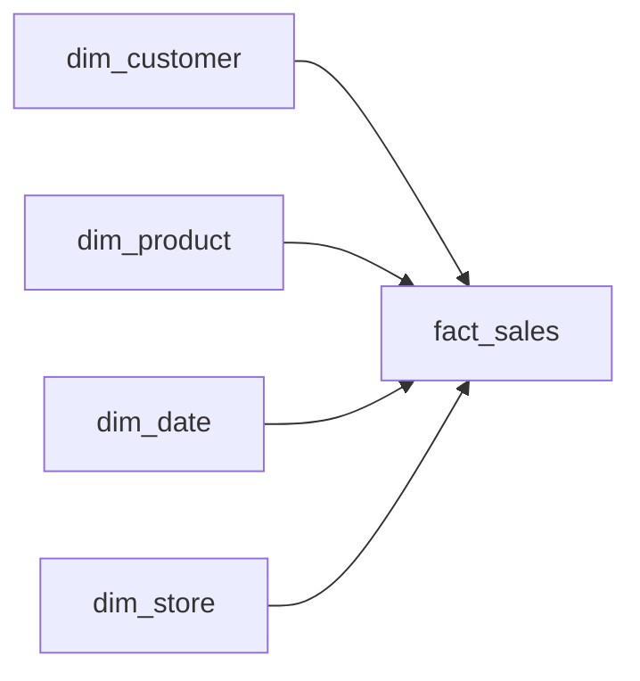
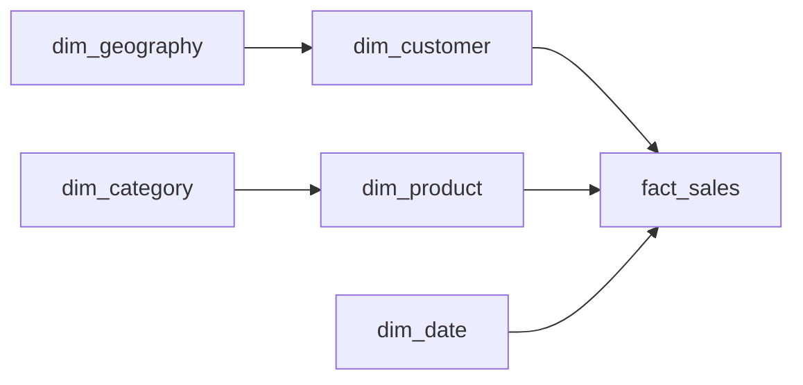

# Dimensional Modeling for Analytics

## Understanding Star and Snowflake Schemas

### Introduction to Dimensional Modeling

Dimensional modeling is a critical technique for designing databases optimized for analytical workloads. The star schema and snowflake schema are two common approaches to organizing data in a data warehouse, enabling efficient querying and reporting. This lesson will explore these schemas in detail, highlighting their structure, advantages, and use cases.

- Star Schema: A simple and highly denormalized structure with a central fact table and directly connected dimension tables.
- Snowflake Schema: A normalized extension of the star schema, where dimension tables are further broken down into sub-dimension tables.
- Dimensional Modeling Benefits: Enhances query performance, simplifies analytics, and supports scalability.

### Key Components of a Star Schema

In a star schema, the fact table contains measurable business metrics, such as sales or revenue, while dimension tables store descriptive attributes like product names, customer details, and dates. The star-like structure arises because each dimension table is directly connected to the central fact table.

> Star Schema Structure

Each dimension key joins many sales rows to one dimension row. The example fact grain is one sold order line.

### Advantages of Star Schema

A star schema gives analysts a clear path from measures to descriptive attributes and usually requires fewer joins than a normalized dimensional model. Shared dimensions support consistent filtering across reports. Its simple structure often helps BI tools generate understandable SQL, although actual speed depends on the engine, data layout, and query.

### Limitations of Star Schema

Denormalized dimensions repeat descriptive attributes, so updates and data quality rules must keep those attributes consistent. Large dimensions can consume additional storage, and complex hierarchies may be harder to maintain. A star schema still requires a declared fact grain and careful join logic to prevent double-counting.

### Understanding the Snowflake Schema

The snowflake schema is an extension of the star schema that normalizes dimension tables by breaking them into sub-dimension tables. This results in a more complex structure but reduces data redundancy and storage requirements.

> Snowflake Schema Structure

Normalized sub-dimensions reduce repeated descriptions but introduce additional joins.

### When to Use a Star Schema

Choose a star schema when query performance is a priority and storage costs are not a major concern.

#### What is the primary advantage of a star schema?

High query performance due to its simple, denormalized structure.

#### What is the key difference between a star schema and a snowflake schema?

Star schema is denormalized, while snowflake schema is normalized with sub-dimension tables.

#### Which schema is better for reducing storage requirements?

Snowflake schema, due to its normalized structure.

#### Which schema is generally easier to query and understand?

- Star Schema
- Snowflake Schema

**Answer:** **Star Schema.** Dimensions connect directly to the fact table, so typical analytical queries need fewer joins.

## Designing Fact Tables and Dimension Tables

### Introduction to Fact and Dimension Tables

Fact tables and dimension tables are the building blocks of dimensional modeling in data warehousing. Fact tables store quantitative data for analysis, while dimension tables provide descriptive attributes that categorize and add context to the facts. Designing these tables correctly is crucial for enabling efficient analytical queries and reporting.

- Fact tables primarily contain numerical data such as sales, revenue, or counts.
- Dimension tables contain descriptive data such as product names, customer details, or time periods.
- Relationships between fact and dimension tables are typically defined using foreign keys.

#### What type of data do fact tables store?

Fact tables store numerical data that can be aggregated for analysis, such as sales or revenue.

#### What is the role of dimension tables?

Dimension tables provide descriptive attributes that add context to the facts, such as product or customer information.

#### How are fact and dimension tables linked?

Fact and dimension tables are linked through foreign keys, forming relationships for analytical queries.

> Fact Table and Dimension Table Relationships

| Table | Example columns | Grain |
| --- | --- | --- |
| `dim_customer` | `customer_key`, `customer_id`, `customer_name`, `region` | One customer version |
| `dim_product` | `product_key`, `product_name`, `category` | One product version |
| `fact_sales` | `order_line_id`, `customer_key`, `product_key`, `quantity`, `sales_amount` | One order line |

Dimension keys are unique at their version grain. Logical foreign-key relationships must be tested even on platforms that do not enforce them.

### Design Principles for Fact Tables

Declare the **grain** before selecting columns: for example, one row per order line. Store dimension keys and measures at that same grain. Decide whether measures are additive, semi-additive, or non-additive: sales amount can be summed; an account balance cannot be summed across dates; a percentage usually must be recomputed from its numerator and denominator. Use a unique business-event key or deduplication rule, and define how corrections and late events are handled.

### Design Principles for Dimension Tables

Give each entity a stable business key and, when useful, a separate surrogate key for warehouse joins and historical versions. Keep readable descriptive attributes, define SCD rules per attribute, and provide a documented unknown-member value when a dimension record arrives late. Use conformed definitions for dimensions shared across fact tables. For Type 2 dimensions, each fact must reference the version effective when the event occurred.

#### Which of the following is NOT typically found in a dimension table?

- Customer Name
- Region
- Sales Amount
- Product Category

**Answer:** **Sales Amount.** It is a measure normally stored in a fact table at the declared business-event grain.

- **Step 1: Identify Business Processes**

  Determine the key business processes that generate measurable data, such as sales transactions or inventory management.

- **Step 2: Define the Facts**

  Declare the fact grain, select measures at that grain, and define aggregation rules and the event deduplication key.

- **Step 3: Design Dimension Tables**

  Define customer, product, and date attributes, assign their keys, and choose the SCD policy for attributes that change.

- **Step 4: Establish Relationships**

  Join facts to valid dimension versions using surrogate keys; test missing keys and verify that a join does not increase the number of fact rows.

### Define Key Metrics

Ensure the fact table captures all critical numerical data required for analysis.

#### Fact tables store ______ data, while dimension tables provide ______ attributes.

**Answer:** **Quantitative (numerical)** data; **descriptive** attributes. Fact tables also contain keys and can be factless when they record event occurrence rather than numeric measures.

## Best Practices for Handling High Cardinality Dimensions

### Introduction to High Cardinality Dimensions

High cardinality dimensions are those that contain a large number of unique values, such as customer IDs, transaction IDs, or email addresses. These dimensions can pose challenges in terms of storage, performance, and efficient querying, especially in analytics and reporting scenarios. Understanding best practices for handling high cardinality dimensions is essential for maintaining a performant and scalable data architecture.

- Understand the implications of high cardinality on query performance and storage.
- Leverage surrogate keys instead of natural keys to reduce storage overhead.
- Use engine-appropriate indexing, clustering, or partitioning to optimize query performance; avoid high-cardinality directory partitions.
- Consider data aggregation to reduce granularity when appropriate.
- Utilize advanced tools and platforms like Snowflake and Databricks for efficient handling.

### Why High Cardinality Dimensions Matter

A high number of distinct values increases the number of groups in aggregations and can increase join-state memory and data movement. Long string keys add storage and comparison costs. The effect depends on the engine: high cardinality alone does not mean a dimension is incorrectly designed.

### Common Examples of High Cardinality Dimensions

Examples include customer identifiers, device identifiers, email addresses, and transaction identifiers. An identifier used only to label an event, such as an invoice number, may be kept as a **degenerate dimension** in the fact table instead of creating a separate table with no descriptive attributes.

### Challenges in Handling High Cardinality

Potential issues include large lookup tables, expensive grouping, key skew, and excessive partition counts. Do not partition one directory per customer or transaction when that produces tiny files. Select layout keys from real filtering patterns and file sizes; use clustering, indexing, or aggregation only when the chosen engine and workload benefit.

### Best Practices for Optimizing High Cardinality Dimensions

To handle high cardinality dimensions effectively, data engineers and architects should focus on techniques that balance performance and storage efficiency. Below are some key practices to consider.

### Use Surrogate Keys

Replace natural keys with surrogate keys to minimize storage size and improve join performance.

#### What is a high cardinality dimension?

A dimension with a large number of unique values, such as customer IDs or email addresses.

#### Why use surrogate keys for high cardinality dimensions?

Surrogate keys reduce storage overhead and improve join performance by replacing larger natural keys with smaller numeric keys.

#### How can partitioning improve performance?

Partitioning reduces the data scanned during queries by logically grouping data, such as by date or region.

#### Which of the following is NOT a best practice for handling high cardinality dimensions?

- Using surrogate keys
- Partitioning data by logical groupings
- Creating one tiny directory partition for every unique customer ID
- Employing columnar storage and compression

**Answer:** **Creating one tiny directory partition for every unique customer ID.** It creates excessive metadata and small files. An unpartitioned table can be appropriate when engine-managed pruning or clustering serves the workload.

> Using Surrogate Keys for High Cardinality Dimensions

| Business key | Surrogate key | Use |
| --- | --- | --- |
| `customer-000001@example.com` | `101` | Resolve business identity in the dimension |
| `customer-000002@example.com` | `102` | Resolve business identity in the dimension |

A fact row stores `customer_key = 101` instead of repeating the email address. The dimension retains the business key, and Type 2 changes receive separate version keys.

- **Step 1: Identify High Cardinality Dimensions**

  Analyze your data model to identify dimensions with a large number of unique values, such as customer or transaction IDs.

- **Step 2: Implement Surrogate Keys**

  Create a persistent mapping from each business key to a compact surrogate key; keep the mapping stable on reruns and allocate a new version key for Type 2 history.

- **Step 3: Optimize Query Performance**

  Inspect frequent filters and joins, then choose suitable indexing or clustering. Use directory partitioning only when each partition has enough data.

- **Step 4: Monitor and Iterate**

  Compare scan volume, execution time, data skew, and file counts before and after each change; retain only changes that improve the measured workload.

#### High cardinality dimensions often include attributes like ______ and ______, which have a large number of unique values.

**Answer:** **Customer IDs** and **email addresses** are two valid examples.

## Optimizing Performance with Surrogate Keys and Indexing

### Introduction to Surrogate Keys

Surrogate keys are unique identifiers that are generated to represent rows in a table. Unlike natural keys derived from business data, surrogate keys are typically system-generated integers or UUIDs. Using surrogate keys can significantly improve query performance, simplify schema design, and enhance data consistency, particularly in data warehousing scenarios.

- Surrogate keys are immutable and do not change over time.
- They decouple the database schema from business logic.
- Compact integer surrogate keys can reduce repeated key storage compared with long natural keys; UUIDs are larger, and savings depend on the original key and engine encoding.

### Understanding Indexes

Indexes are database structures that improve the speed of data retrieval operations. They work by creating a data structure—such as a B-tree or hash map—that allows queries to locate rows efficiently. Proper indexing is critical for optimizing query performance in large datasets.

### Clustered Indexes

In engines such as SQL Server, a clustered index stores the table rows at the leaf level in clustered-key order; a table therefore has one clustered index. Inserts and updates can require page maintenance, so the key choice affects write cost as well as reads. This is an engine-specific index structure, not Snowflake micro-partition clustering.

### Non-Clustered Indexes

A non-clustered index is a separate structure containing index keys and row locators. It can accelerate selective filters and joins, and included columns can cover a query. Multiple indexes consume space and increase write maintenance. Exact behavior and syntax vary by database engine.

### Composite Indexes

A composite index uses multiple key columns. In a B-tree engine, an index on `(customer_id, order_date)` is commonly useful for a customer filter followed by a date range; it is not generally equivalent to `(order_date, customer_id)`. Choose key order using query predicates and validate with execution plans. Snowflake standard tables and Delta tables do not use these conventional B-tree indexes.

> Benefits of Surrogate Keys in Data Warehousing

| Requirement | How the surrogate key helps |
| --- | --- |
| Business key changes | Fact references do not need to use the changing business identifier |
| Type 2 history | Each historical version receives its own key |
| Repeated long keys | A compact integer can reduce fact-table key size |
| Reliable reloads | A persistent mapping preserves key assignments |

#### What is a surrogate key?

A surrogate key is a system-generated unique identifier used to represent rows in a table, typically an integer or UUID.

#### Why is indexing important?

Indexing improves the performance of data retrieval operations by enabling faster query execution through organized data structures.

#### What is the difference between clustered and non-clustered indexes?

A clustered index determines the physical order of data, while a non-clustered index is stored separately and contains pointers to the data.

- **Step 1: Identify Candidate Keys**

  Determine the natural keys in your dataset and assess whether they are suitable for use as primary keys. If not, consider using surrogate keys.

- **Step 2: Generate Surrogate Keys**

  Use an identity, sequence, or durable key-mapping process. Enforce logical uniqueness and preserve assigned keys across reloads; do not regenerate row numbers as permanent keys.

- **Step 3: Implement Indexing**

  For a relational engine, index selective join and filter columns. For Snowflake analytical tables, inspect pruning and clustering; for Delta, consider supported clustering and file layout instead of B-tree DDL.

- **Step 4: Test Query Performance**

  Compare execution plans and representative query times, including load/update overhead and storage cost. Check both selective and broad analytical queries.

#### A ______ index determines the physical order of data in a table, while a ______ index is stored separately and contains pointers to data rows.

**Answer:** **Clustered**; **non-clustered**, in the SQL Server-style index model described here. These terms do not describe Snowflake analytical-table clustering.

#### What is the primary advantage of using surrogate keys in data warehousing?

- They are easier to remember than natural keys.
- They reduce database storage requirements and improve performance.
- They eliminate the need for indexing.
- They allow tables to store unlimited rows.

**Answer:** **They reduce database storage requirements and improve performance**, when compact numeric keys replace larger business keys. They also separate business identity from version identity; performance improvements must be measured.

### References

- [SQL Server clustered and nonclustered indexes](https://learn.microsoft.com/en-us/sql/relational-databases/indexes/clustered-and-nonclustered-indexes-described)
- [Snowflake clustering keys](https://docs.snowflake.com/en/user-guide/tables-clustering-keys)
