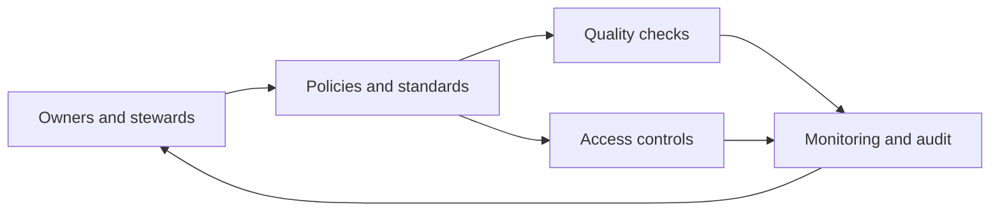

# Foundations of Modern Data Architectures

## Introduction to Data Warehouses, Data Lakes, and Lakehouses

### What Are Data Warehouses?

A data warehouse is a centralized repository designed for analytical processing and reporting. It is optimized for read-heavy workloads and structured data. Data warehouses are built on a schema, typically a star or snowflake schema, and are used for business intelligence applications, dashboards, and complex queries.

### What Are Data Lakes?

A data lake is a large storage repository designed to store vast amounts of raw, unstructured, and semi-structured data. A raw data lake can ingest files without imposing a shared table schema, providing flexibility for later processing. Individual formats, ingestion tools, and curated lake tables can still enforce schemas.

### What Are Lakehouses?

A lakehouse combines the best features of data warehouses and data lakes. It provides the scalability and flexibility of a data lake while supporting schema enforcement, transactions, and analytical performance similar to a data warehouse. Technologies like Delta Lake and Apache Hudi power many modern lakehouses.

- Data Warehouses: Optimized for structured, analytical data with predefined schemas.
- Data Lakes: Ideal for retaining raw, unstructured, semi-structured, and structured data; schema enforcement depends on the ingestion and table layer.
- Lakehouses: Hybrid systems that combine the scalability of data lakes with the transactional consistency of data warehouses.

> Comparison of Data Warehouses, Data Lakes, and Lakehouses.

| Architecture | Typical storage and structure | Common workloads |
| --- | --- | --- |
| Warehouse | Managed analytical tables with defined schemas | Governed SQL reporting and BI |
| Lake | Raw files and curated datasets in object storage | Exploration, data science, and large-scale processing |
| Lakehouse | Lake storage with transactional table metadata | Shared BI, streaming, and ML datasets |

#### What is a data warehouse optimized for?

A data warehouse is optimized for analytical processing and reporting on structured data.

#### What type of data does a data lake store?

A data lake stores raw, unstructured, and semi-structured data without enforcing a schema.

#### What is a lakehouse?

A lakehouse is a hybrid system that combines the scalability of data lakes with the transactional and analytical capabilities of data warehouses.

#### Which of the following is a key feature of a data lake?

- Schema enforcement during ingestion
- Optimized for structured data
- Scalable storage for raw, unstructured data
- Designed for dashboards and reporting

**Answer:** **Scalable storage for raw, unstructured data.** A raw lake can retain data before a common analytical schema is applied.

### Use Cases of Data Warehouses

Data warehouses are used for business intelligence, reporting, and querying structured data in a highly organized format. They are ideal for operational and strategic decision-making.

### Use Cases of Data Lakes

Data lakes are used for big data processing, data science workflows, and machine learning applications. They support flexible data exploration and do not require predefined schemas.

### Use Cases of Lakehouses

Lakehouses are used when a unified platform is needed for both structured and unstructured data. They support real-time analytics, machine learning, and data warehousing capabilities in a single system.

### Data Warehouses

Centralized, schema-based systems optimized for structured data and analytical queries.

## Comparing Use Cases: When to Use Each Architecture

### Understanding Architecture Selection

Choosing the right data architecture—data warehouse, data lake, or lakehouse—depends on the specific needs of your organization. Each architecture type is optimized for different scenarios, and understanding when to use each is critical for building scalable, cost-effective, and efficient data systems.

- Data Warehouses: Best for structured data and BI-focused analytics.
- Data Lakes: Ideal for unstructured and semi-structured data at scale.
- Lakehouses: Combines the best of both worlds with support for ACID transactions and diverse data formats.

### When to Choose a Data Warehouse

Choose a warehouse when analysts need governed business metrics, predictable SQL reporting, and consistent schemas. Typical workloads include finance dashboards, sales reporting, and recurring aggregations. Use an operational database for transactional application writes; a warehouse serves analytical decision-making.

### When to Choose a Data Lake

Choose a lake when the priority is retaining large volumes of raw files, logs, images, or semi-structured events for exploration and machine learning. Object storage is economical and flexible, but catalogs, access control, data quality checks, and processing engines must still be designed.

### When to Choose a Lakehouse

Choose a lakehouse when BI, batch processing, streaming, and machine learning need to use shared data with transactional tables. Its table layer supplies schema management and consistent writes; query latency, governance, operational complexity, and cost must still be evaluated for the actual workload.

> Comparison of Use Cases for Different Data Architectures

| Main requirement | Starting choice | Decision to verify |
| --- | --- | --- |
| Consistent finance and sales dashboards | Warehouse | SQL latency, concurrency, and governance |
| Raw log and media retention | Lake | Cataloging, access control, and processing tools |
| BI and ML on shared transactional tables | Lakehouse | Engine support, maintenance, and operating cost |

#### What is the primary use case for a data warehouse?

Data warehouses are primarily used for structured data and BI-focused analytics.

#### What type of data is best suited for a data lake?

Data lakes are best for unstructured and semi-structured data, often used in machine learning and data science.

#### How does a lakehouse differ from a data warehouse?

Lakehouses combine the BI and transactional capabilities of data warehouses with the flexibility of data lakes.

#### Which architecture would you choose for storing and analyzing petabytes of log data?

- Data Warehouse
- Data Lake
- Lakehouse

**Answer:** **Data Lake**, when the requirement is economical raw-log retention and flexible exploration. A lakehouse is also appropriate if those logs must additionally support transactional tables and governed BI. The question assumes raw retention is the deciding requirement.

Selecting the right architecture is not always a clear-cut decision. Many organizations adopt a hybrid approach, using multiple architectures to serve different needs. For example, a company might use a data lake for raw data storage and machine learning and a data warehouse for reporting and BI dashboards.

### Considerations for Choosing an Architecture

Evaluate data types, SQL performance targets, ingestion latency, historical retention, access policies, existing team skills, and total operating cost. Compare each architecture against representative queries and data volumes; the storage format alone does not determine performance.

## Core Principles of Data Governance and Scalability

### Introduction to Data Governance

Data governance refers to the framework and set of practices that ensure data is managed and used effectively, securely, and reliably. It encompasses policies, roles, responsibilities, and processes that guide data usage to meet organizational goals while ensuring compliance and data quality.

- Establishing clear roles and responsibilities for data management.
- Ensuring data integrity, accuracy, and quality.
- Implementing access controls and security measures.
- Complying with legal and regulatory requirements.
- Defining data ownership and accountability.

> Key Components of Data Governance Framework

### Scalability in Modern Data Architectures

Scalability refers to the ability of a data system to handle increasing amounts of data and workloads efficiently. In modern data platforms, scalability is achieved through a combination of architecture design, resource optimization, and advanced processing techniques.

### Horizontal vs. Vertical Scalability

**Horizontal scaling** adds workers or nodes so that storage, processing, or concurrent requests can be distributed. **Vertical scaling** increases the resources of an existing machine or compute service, such as CPU and memory. Horizontal scaling introduces coordination and data-shuffle costs; vertical scaling eventually reaches a machine-size limit. Neither automatically fixes skewed data or inefficient queries.

### Role of Cloud Platforms in Scalability

Cloud platforms provide object storage, configurable compute, autoscaling, and managed services so capacity can change without purchasing hardware. Separating storage from compute lets several workloads share stored data while using independent compute resources. Set limits, shutdown policies, and monitoring because elastic capacity can also increase spending.

### Challenges in Scalability

Common challenges include uneven data distribution, expensive joins and shuffles, too many small files, concurrent workloads competing for resources, and maintaining consistent results during updates. Address these with appropriate data layout, incremental processing, workload isolation, and measurements of latency, throughput, and cost.

#### What is the primary goal of data governance?

To ensure data is managed and used effectively, securely, and reliably while meeting compliance and quality standards.

#### What is horizontal scalability?

The process of adding more machines or nodes to a system to handle increased workloads.

#### Name one challenge of scalability in modern data platforms.

Ensuring data consistency in distributed systems.

### Define Roles and Responsibilities

Ensure clear data ownership and accountability across teams.

#### Which of the following best defines data governance?

- A framework for handling data storage costs.
- A set of practices for managing and ensuring data quality, security, and compliance.
- A method for scaling data warehouses.
- A policy for defining data processing pipelines.

**Answer:** **A set of practices for managing and ensuring data quality, security, and compliance.** Governance also assigns ownership and accountability.

## Key Technologies: Snowflake, Databricks, and Delta Lake Overview

### Introduction to Key Technologies

Modern data engineering relies on powerful platforms to handle the complexities of data processing, storage, and analysis. This lesson provides an overview of three essential technologies—Snowflake, Databricks, and Delta Lake—that are redefining how organizations manage data.

### Snowflake Overview

Snowflake is a managed cloud data platform with storage and virtual warehouses for compute. Independent warehouses can serve ingestion and reporting without sharing the same compute allocation. Its native analytical tables use automatically managed micro-partitions, while roles, policies, and secure sharing support governance.

### Databricks Overview

Databricks provides a managed environment for distributed processing, SQL analytics, notebooks, workflow scheduling, and machine learning. Apache Spark supplies a major processing engine; Unity Catalog provides centralized discovery and access governance for supported assets. Delta tables are a common storage format for reliable lakehouse pipelines.

### Delta Lake Overview

Delta Lake is a table storage layer, rather than a complete hosted analytics platform. It combines data files with a transaction log to provide ACID writes, schema enforcement, and versioned snapshots. Databricks uses Delta Lake, and compatible engines can also use Delta tables outside Databricks.

- Snowflake: Ideal for structured data and analytical workloads.
- Databricks: Optimized for big data processing, machine learning, and streaming analytics.
- Delta Lake: Enhances data lakes with features like ACID compliance and schema enforcement.

### Why Use Snowflake?

Snowflake is renowned for its simplicity, performance, and advanced features such as automatic clustering and data sharing. Its multi-cluster architecture allows for seamless scaling, making it a preferred choice for modern analytical workloads.

### Why Use Databricks?

Databricks offers a collaborative and scalable environment for data engineers and data scientists. Its tight integration with Apache Spark allows for distributed data processing, while its support for multiple languages like Python, R, and SQL ensures flexibility.

#### What is Snowflake's primary strength?

Scalable, cloud-native data warehousing with advanced governance and performance features.

#### What is Databricks built on?

Apache Spark.

#### What does Delta Lake bring to data lakes?

ACID transactions, scalable metadata handling, and schema enforcement.

#### Which of the following platforms is best suited for collaborative data science and machine learning?

- Snowflake
- Databricks
- Delta Lake

**Answer:** **Databricks**, among the listed options, because it integrates collaborative development, distributed processing, and ML workflows. Snowflake also supports ML capabilities; this is a comparison of the emphasis described in this lesson.

### Snowflake

Ensure understanding of its separation of storage and compute and its ability to handle structured data.

> Key Features of Snowflake, Databricks, and Delta Lake

| Technology | Role | Representative capability |
| --- | --- | --- |
| Snowflake | Managed data platform | Independent SQL warehouses and secure data sharing |
| Databricks | Analytics and engineering platform | Spark processing, notebooks, workflows, and ML |
| Delta Lake | Transactional table storage layer | Transaction log, schema validation, and time travel |

### References

- [Snowflake architecture](https://docs.snowflake.com/en/user-guide/intro-key-concepts)
- [Databricks platform overview](https://docs.databricks.com/aws/en/introduction/)
- [Delta Lake overview](https://docs.delta.io/)
